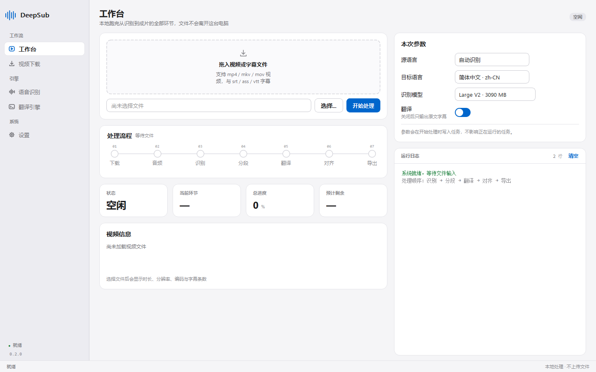
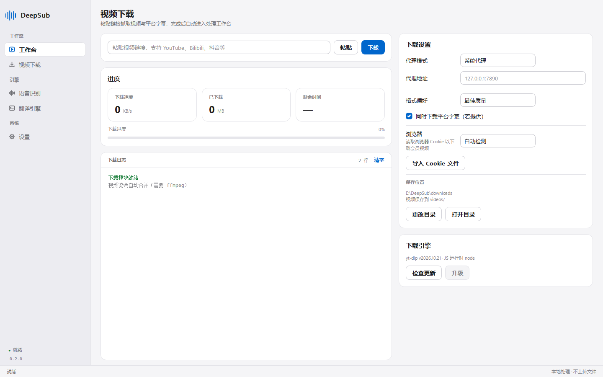

# DeepSub

一个 Windows 上的视频字幕流水线工具：**下载 → 提取音频 → 语音识别 → 语义分段 → 本地大模型翻译 → 对齐还原 → 导出字幕**，全程在本机完成。

> 这是一个**自用工具**，为了自己看外语视频时能拿到还算不错的字幕而写的。  
> 部分功能还不完善或者没有测试，遇到问题我会尽快修，欢迎提 Issue 或 PR。



## 它做了什么

| 环节      | 用的东西                       | 说明                                 |
| ------- | -------------------------- | ---------------------------------- |
| 01 视频下载 | yt-dlp                     | 链接直下，支持代理、浏览器 Cookie、平台字幕、播放列表     |
| 02 音频提取 | ffmpeg                     | 统一转 FLAC，流式处理，不整段读进内存              |
| 03 语音识别 | faster-whisper             | 词级时间戳 + Silero VAD 前置静音过滤，参数全部可调   |
| 04 语义分段 | pysbd + 词级时间戳              | 优先保证每行是完整句意；超 8 秒在真实停顿处切，避免字幕横跨静音  |
| 05 翻译   | llama.cpp / 任意 OpenAI 兼容接口 | 翻译 + 滑动窗口上下文 + 术语表 + 文体识别          |
| 06 对齐还原 | AI 语义分析                    | 译文过长时在自然断句处再切，并用词级时间戳重算时间轴         |
| 07 字幕导出 | 内置转换器                      | SRT / ASS / VTT，单语 / 双语，ASS 可套样式模板 |




## 快速开始

### 方式一：下载绿色版

到 [Releases](../../releases) 下 `DeepSub-v*-win64.zip`，解压后双击 `DeepSub.exe`，首次启动会走一遍新手引导。  
免安装，卸载直接删文件夹。

### 方式二：源码运行

需要 Windows 10/11 x64 + Python 3.10+（开发环境是 3.12）。

```bash
git clone https://github.com/Z5093/DeepSub.git
cd DeepSub
pip install -r requirements.txt
python main.py
```

然后把外部工具放进 `resource/bin/`：

```
resource/bin/
├── ffmpeg.exe     # 音频提取、音视频合并
├── ffprobe.exe    # 读取视频信息
├── yt-dlp.exe     # 视频下载（也可用系统 PATH 里的）
└── 7z.exe         # 解压 faster-whisper 安装包
```

这些文件体积较大，**没有放进仓库**，请自行从各自官方渠道下载。缺少时对应功能会提示，其余功能仍可用。

> `yt-dlp.exe` 必须是[官方 standalone 单文件](https://github.com/yt-dlp/yt-dlp/releases/latest)（20MB 起）。
> pip 装出来的 `yt-dlp.exe` 只有 ~100KB，本质是指向本机 python 的启动壳，
> 换台机器就起不来，构建脚本会用体积阈值把它拦下来（见下文自检）。

## 外部依赖

程序本身只是外壳，真正干活的是这些独立组件，第一次使用需要准备：

1. **faster-whisper**（语音识别）  
   在「语音识别 → 程序管理」里一键下载安装，CPU / GPU 两个版本按显卡自动推荐；  
   模型在「模型管理」里选，支持 ModelScope / HuggingFace 双源。
2. **llama.cpp + Index-Translate**（本地翻译，可选）  
   在「翻译引擎」里指定 `llama-server` 目录与 `.gguf` 模型，可一键启停。  
   纯 CPU 也能跑小参数模型；也可以用官方在线接口，或任何 OpenAI 兼容服务（DeepSeek、通义、Ollama、vLLM…），在「设置 → 翻译」里填地址和 Key 即可。

## 打包 exe

```bash
pip install -r requirements-dev.txt
python scripts/build_exe.py          # 产出 dist/DeepSub/DeepSub.exe
python scripts/build_exe.py --zip    # 顺便打发布包
python scripts/build_exe.py --no-bin # 不拷贝 ffmpeg 等大文件，只出程序本体
```

打包用的是 PyInstaller 的 onedir 模式，而不是单文件：`resource/` 与 `config/` 放在 exe 同级，用户可以直接替换 ffmpeg / yt-dlp、改配置；`models/faster-whisper`、`tools/` 在首次使用时按需下载。

构建脚本会做三件容易漏的事，并在最后跑一遍产物自检（缺文件或 `yt-dlp.exe` 是 pip 启动壳会直接失败）：

1. 把 `resource/{icons,fonts,styles}` 和 `resource/bin` 拷到 exe 同级；
2. 把 `models/silero-vad/silero_vad.onnx`（2.3MB 静音检测模型）一并带上——不带的话程序会去 GitHub 现下，下不动就静默退化成定长分块；
3. `models/faster-whisper`（3.4GB）**不打进包**，由「语音识别」页按需下载。

实测产物（v0.2.0）：`DeepSub.exe` 约 29 MB，整个目录约 720 MB（其中 464 MB 是 gyan full build 的 ffmpeg + ffprobe），打成 zip 后 321 MB。

如果只想要程序本体，用 `--no-bin` 构建，产物约 230 MB，运行时自己把四个工具丢进 `resource/bin/` 即可。

之所以不做成一个 exe：单文件模式每次启动都要把 200 MB+ 解压到临时目录，启动要十几秒，还更容易被杀毒软件误报；而且内置工具本来就需要能被用户替换。

## 目录结构

```
DeepSub/
├── main.py                  # 入口
├── app/
│   ├── common/              # 配置、常量、信号总线、设计令牌、路径解析
│   ├── components/          # 自绘 UI 组件（按钮/卡片/流程轨道/图标）
│   ├── core/
│   │   ├── downloader/      # yt-dlp 封装
│   │   ├── asr/             # faster-whisper 调用、VAD、分块
│   │   ├── translator/      # 提示词、术语表、滑动窗口、风格识别
│   │   ├── subtitle/        # 语义分段、AI 对齐、格式转换、样式
│   │   └── utils/           # ffmpeg / yt-dlp / 缓存 / 语言码等
│   ├── thread/              # QThread 工作线程
│   └── view/                # 主窗口与各功能页
├── resource/                # 图标、字体、样式；bin/ 放外部工具
├── scripts/                 # 构建与开发脚本
├── tests/                   # 离线回归测试
└──docs/                    # 截图与设计笔记
```

跑一下离线测试（用假 translator，不联网、不加载模型，秒级完成）：

```bash
python tests/test_translation_flow.py
```

## 已知不足

说得直白一些，下面这些是明确还没做好的：

- **只测过 Windows 10/11 x64**，其他平台没试过；CI 只跑 Linux 上的离线回归测试，打包流程本身没有自动化。
- **没有系统测试用例**，主流程是人工跑真实视频验证的，边界情况（异常字幕、超长行、字符编码）保不齐会翻车。
- **批量队列、自动更新、插件系统**只在设计里，还没实现。
- **界面只有中文**，高 DPI 缩放下个别控件可能错位。
- 翻译质量高度依赖所选模型；小模型在专有名词和口语梗上会翻得生硬。
- 下载能力受平台策略影响，会员 / 需登录的视频要导入浏览器 Cookie，随时可能因为站点改动失效（届时升级 `yt-dlp.exe` 通常能解决）。

## 致谢

这个项目基本是站在别人肩膀上搭起来的，感谢这些开源项目与团队：

- [**yt-dlp**](https://github.com/yt-dlp/yt-dlp) — 视频下载的核心，本项目只是给它套了个界面。
- [**Index-Translate**](https://github.com/bilibili/Index-Translate)（bilibili Index LLM 团队）— 翻译质量的关键。提示词按它的官方 instTrans 结构来写（`【源文】` + 编号约束 + `只输出译文`），本地默认跑的就是 [Index-Translate-9B](https://www.modelscope.cn/collections/IndexTeam/Index-Translate)；[在线 Demo](https://index-translate.bilibili.com/)。
- [**faster-whisper**](https://github.com/SYSTRAN/faster-whisper) 与 [whisper-standalone-win](https://github.com/Purfview/whisper-standalone-win) — 识别引擎与免安装 Windows 版本。
- [**Silero VAD**](https://github.com/snakers4/silero-vad) — 静音过滤，长音频里省掉大量无效计算。
- [**llama.cpp**](https://github.com/ggml-org/llama.cpp) — 本地推理服务端。
- [**FFmpeg**](https://ffmpeg.org/) — 音视频处理的事实标准。
- [**PyQt5**](https://riverbankcomputing.com/software/pyqt/) / [**Qt**](https://www.qt.io/) — 界面框架。
- [**pysbd**](https://github.com/nipunsadvilkar/pySBD) — 句边界检测。
- [**7-Zip**](https://www.7-zip.org/) — 安装包解压。

## 第三方组件与许可

本仓库只包含 DeepSub 自己的代码（MIT）。发布用的绿色版 zip 里额外打包了这些**独立程序**，版权归各自作者，请按其许可使用与再分发：

| 组件 | 许可 | 说明 |
| --- | --- | --- |
| [ffmpeg / ffprobe](https://ffmpeg.org/) | GPL v3（gyan full build） | 独立进程调用；如二次分发请一并提供源码或指向官方 |
| [yt-dlp](https://github.com/yt-dlp/yt-dlp) | Unlicense | 官方 standalone 单文件 |
| [7-Zip](https://www.7-zip.org/) | LGPL | 仅用于解压 faster-whisper 安装包 |
| [Silero VAD](https://github.com/snakers4/silero-vad) | MIT | `models/silero-vad/silero_vad.onnx` 随仓库与发布包分发 |

faster-whisper、Whisper 模型、llama.cpp 与翻译模型都**不随包分发**，由用户按各自许可自行下载。

## 免责声明

- 本项目仅供个人学习与技术研究使用，**请勿用于商业用途或二次分发受版权保护的内容**。
- 下载、识别、翻译他人作品时请遵守所在地区法律与平台服务条款，尊重原作者版权；由此产生的一切后果由使用者自行承担。
- 项目按「现状」提供，不附带任何明示或暗示的担保。

## License

[MIT](LICENSE)
